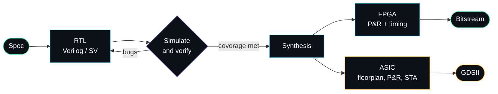
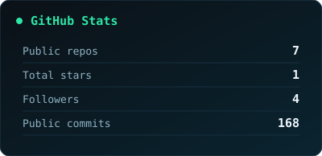
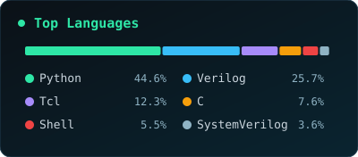

<div align="center">



<a href="https://readme-typing-svg.demolab.com">
  
</a>

<br/>


</div>

---

## `> about_me`

```verilog
module eluva_sreevenkat (
    input  wire clk,          // runs on curiosity
    input  wire rst_n,
    output reg  [31:0] ideas  // pipelined, with hazard detection
);
    always @(posedge clk or negedge rst_n)
        if (!rst_n) ideas <= 32'd0;
        else        ideas <= ideas + 1;   // always shipping
endmodule
```

- 🔬 **ECE engineer** aiming at **ASIC design**: RTL, microarchitecture, verification and the path down to silicon
- 🧠 Building **processors, FIFOs and ALUs** from scratch, then breaking them with testbenches
- ⚡ Working on **FPGA accelerators** for image and neural-network workloads
- 🧮 Exploring **posit arithmetic** and low-precision MAC units, aimed at both FPGA and ASIC implementation
- 📐 Learning the **RTL-to-GDSII flow**: synthesis, static timing analysis, and power, performance and area (PPA) trade-offs
- 🌱 Learning more **UVM**, constrained-random testing and coverage-driven verification

---

## `> toolchain`

| Domain | Stack |
| :-- | :-- |
| **ASIC design** |     |
| **HDL** |   |
| **Verification** |   |
| **FPGA / EDA** |   |
| **Architecture** |   |
| **Scripting & tools** |     |

---

## `> featured_projects`

<table>
  <tr>
    <td width="50%" valign="top">
      <h3>🖼️ <a href="https://github.com/sreeveenkat/FPGA-Image-Super-Resolution-Accelerator">FPGA Image Super-Resolution Accelerator</a></h3>
      Hardware acceleration of image super-resolution on FPGA.<br/><br/>
      
    </td>
    <td width="50%" valign="top">
      <h3>🧪 <a href="https://github.com/sreeveenkat/Sync-FIFO-UVM-Verification">Sync FIFO - UVM Verification</a></h3>
      UVM environment for verifying a synchronous FIFO.<br/><br/>
      
    </td>
  </tr>
  <tr>
    <td width="50%" valign="top">
      <h3>🧠 <a href="https://github.com/sreeveenkat/risc-v">RV32I 5-Stage Pipelined CPU</a></h3>
      32-bit RISC-V (RV32I) pipelined processor in Verilog with hazard detection and forwarding.<br/><br/>
      
    </td>
    <td width="50%" valign="top">
      <h3>🔁 <a href="https://github.com/sreeveenkat/fifo">Sync &amp; Async FIFO</a></h3>
      Parameterizable RTL FIFOs with Gray-code pointer synchronization, checked with a Verilog testbench.<br/><br/>
      
    </td>
  </tr>
  <tr>
    <td width="50%" valign="top">
      <h3>🛡️ <a href="https://github.com/sreeveenkat/Fault-Tolerant-ALU-16bit">Fault-Tolerant 16-bit ALU</a></h3>
      16-bit ALU designed with fault tolerance in mind.<br/><br/>
      
    </td>
    <td width="50%" valign="top">
      <h3>⚙️ <a href="https://github.com/sreeveenkat/CPU-32-Bit">32-bit CPU</a></h3>
      A 32-bit CPU core written in Verilog.<br/><br/>
      
    </td>
  </tr>
</table>

---

## `> design_flow`

How I take an idea from spec to a working FPGA design or an ASIC layout:



---

## `> github_stats`

<div align="center">




</div>

---

## `> connect`

<div align="center">

[](https://github.com/sreeveenkat)


<sub><code>// open to collaborating on ASIC, RTL, verification and FPGA projects</code></sub>

</div>
